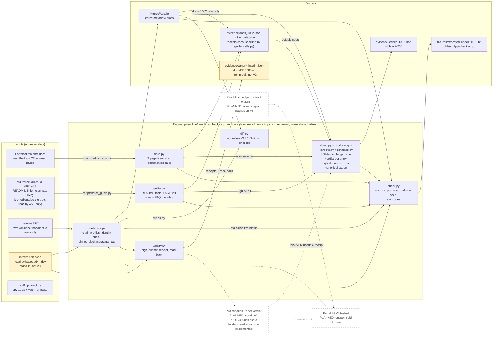

# Plumbline

**Checks Portaldot's documented calls against the runtime they claim to describe: documented call → verdict → proof.** Today it gives a verdict for every documented call (measured on mainnet spec 1002) and has a proof runner that works end to end on a local stand-in chain (not V3). Its proofs on Portaldot V3 are **pending**: the V3 testnet endpoint did not resolve on 2026-10-14.


> Check-in README (v1, 2026-10-14). It describes what exists in this repository today; planned parts are marked
> **planned**. No claim is made about Portaldot V3 behaviour anywhere in this file: every chain measurement is either
> the Portaldot mainnet runtime (spec 1002, read-only) or a local stand-in chain (`interim-sdk`, **not V3**). One cited
> exception: the two wasm cells inside `plumbline check` rest on a 2026-10-11 measurement on a local spec-1002 chain, made
> before this repository existed and not re-run here (see `docs/BASELINE-1002.md`).

## Project Name

**Plumbline** (`portaldot-plumbline`, CLI `plumbline`) — team `edycu`, Portaldot Hacker House 2026, track Modular Cloud & Middleware.

## Project Overview

### Problem Statement

Developers build against Portaldot from its published documentation. The documentation and the runtime can disagree:
a page documents an extrinsic the runtime does not have, or documents arguments the runtime does not take. (The pages do
not say which runtime spec they describe; Plumbline treats them as describing the live runtime, so a gap is either a
documentation defect or documentation for a different runtime version, and both are worth knowing.) One way to
find out is to submit a transaction and read the error, and every runtime upgrade can move that line again.

### Solution

Plumbline reads the documented call surface and a runtime's own metadata, compares them call by call, and writes one
verdict per call into a drift ledger. A call is **PROVEN** only when a canary transaction for it succeeded on that
runtime and was read back from its block; otherwise the ledger says what it could and could not establish
(ABSENT, DRIFTED, ARG_DRIFT, UNPROVEN, …; definitions in `plumbline/verdicts.py`).

**The core flow, with what exists today:**

| Step | What Plumbline does | Status |
|---|---|---|
| 1. Documented call | Parses the 22 mainnet extrinsic docs pages (196 calls) and the V3 guide at commit `d671a32` (46 sample-code `compose_call` sites, 12 FAQ modules) | shipped |
| 2. Verdict | Joins each entry to one runtime's metadata and writes exactly one verdict, stamped with profile, spec version and metadata hash | shipped on `mainnet-1002`; V3 **pending** |
| 3. Proof | Signs a canary extrinsic, keeps the receipt, re-reads it from its block by hash | shipped on a local stand-in chain (`interim-sdk`, **not V3**); no proof on a Portaldot chain yet, so the shipped ledger has **no PROVEN row** |

**Measured on the Portaldot mainnet runtime (spec 1002, read-only), 2026-10-14:**

| `mainnet-1002` baseline | Count |
|---|---|
| Extrinsic docs pages parsed | 22 / 22 |
| Documented calls | 196 |
| Match (name and arguments) | 117 |
| Documented but absent from the runtime | 64 (62 ABSENT, 2 DRIFTED: `Proxy.create_pure` / `kill_pure` → `Proxy.anonymous` / `kill_anonymous`) |
| Documented with arguments that differ from the runtime | 15 (4 of them differ only by a leading underscore on the runtime's parameter name) |
| Live calls whose names no docs page lists | 23 (2 are the live sides of the renamed proxy calls) |

Full table with producers and dates: [`docs/BASELINE-1002.md`](docs/BASELINE-1002.md). Ledger: `evidence/ledger_1002.json`
(320 verdict rows, blake2-256 `d067b31b…de21ee7`, reproduced byte for byte from freshly fetched inputs).
**101 of the 320 rows come from the V3 guide's own call table, demo scripts and FAQ; their verdicts are computed against
mainnet spec 1002 and are not V3 findings.**

Other tools in the repo: `plumbline diff A B` lists the pallets, calls, arguments, constants and events that differ between
two runtimes (an argument row with equal names but different types is flagged `names_equal`: spelling only or a real change,
the diff cannot tell; type aliases are not resolved, so a same-named alias whose width changes yields no row; it prints a **STAND-IN, NOT V3** banner when a side is the stand-in chain); `plumbline check <dApp dir>
--target <profile>` classifies each call site and wasm import set in a dApp against a runtime (blocking: ABSENT, DRIFTED, ARG_DRIFT,
EXPECTED-REJECT; TYPE-TRAP is not detected yet; wasm verdicts cover two measured cases only), with exit codes 0 / 1 / 2.
A golden `check` output on the mainnet-1002 profile is committed (`fixtures/expected_check_1002.txt`).

### Blockchain Relevance

Plumbline works on Portaldot's own surface: Substrate runtime metadata, the extrinsics the official docs describe, and the
V3 testnet guide. It is meant to be re-run against each runtime Portaldot ships. The target is **Portaldot V3**; the V3
run is **pending**. Until the testnet is reachable, the only Portaldot chain measured is the mainnet runtime (spec 1002,
read-only), as a baseline; a local upstream polkadot-sdk dev chain (`interim-sdk`, a stand-in, **not V3**) is used as test
input and to exercise the canary runner.

## Technical Architecture



Solid boxes exist in this repository; dashed boxes are **planned**; yellow boxes are the stand-in chain and what it
produced (**not V3**). Drawn from the code; explained step by step in [`docs/ARCHITECTURE.md`](docs/ARCHITECTURE.md).

**Core tech stack**

| Part | Choice |
|---|---|
| Blockchain platform | Measured on: Portaldot mainnet, spec 1002, read-only. Target: **Portaldot V3** (**pending**, not yet run). Interim stand-in: upstream polkadot-sdk `substrate-node --dev` (profile `interim-sdk`), **not V3** |
| Contract language | none yet (see Smart Contracts) |
| Frontend framework | none (command-line tool) |
| Other components | Python 3.10+, [`substrate-interface`](https://github.com/polkascan/py-substrate-interface) 1.8.1 + `scalecodec` 1.2.12 (the SDK Portaldot's docs point to), `typer`, `pytest`, SQLite (the ledger) |

**Chain profiles** (`plumbline/metadata.py`): `mainnet-1002` (legacy type-registry preset, Assets u64 override),
`v3` (no preset; a stub until the testnet is reachable), `interim-sdk` (no preset), `stored:<file>` (offline blob). Live
profiles check the chain's identity before decoding and fail loudly on a mismatch: `mainnet-1002` and `interim-sdk` pin
`spec_name`, genesis hash and `spec_version`; `v3` pins only the spec name until the testnet has been observed; `stored:`
profiles are offline and are labelled from the blob's recorded sha256. Every `runtime`, `plumb`, `diff` and `check` result
carries its profile label.

**Third-party inputs are untrusted data.** The V3 guide is cloned at a pinned commit outside this tree and read by AST and
text only, never executed. At HEAD its text is not copied here: `evidence/guide_calls.json` holds names and `file:line`
references only (two short FAQ status phrases appear in the tree snapshots of eight early commits, before `d92203e`; HEAD holds none). The mainnet docs pages are fetched at run time into a gitignored cache.

## Smart Contracts

There is **no contract yet**. The Plumbline Ledger (a Revive Solidity contract that would record verdict-report hashes
on-chain) is **planned** for V3; no directory, address or deployment exists for it. Plumbline is pallet-native today: it
reads chain metadata and sends transactions only to the local stand-in chain.

RPC and SDK calls used, read-only: `state_getRuntimeVersion`, `chain_getBlockHash`, `chain_getFinalizedHead`,
`state_getMetadata`, `state_getStorageHash` (for `:code`), block and extrinsic reads for read-back, and the SDK's own
initialisation calls. `scripts/interim_node.sh` also calls `system_health` with `curl` (isolation check). Extrinsics are
sent only by `plumbline canary`, only to the local `interim-sdk` chain (**not V3**), signed with dev keys:
`Balances.transfer_keep_alive`, `System.remark_with_event` and `Revive.map_account`; each is read back from its block
(`docs/PROOF.md`). Nothing is sent to mainnet or to any Portaldot testnet and nothing is deployed, so there are no
contract, asset or account IDs to list.

## Installation & Setup

**Requirements:** Python 3.10+ (tested on 3.11.1), git, network access to `mainnet.portaldot.io`,
`portaldot-dev.readthedocs.io` and github.com for the live steps. The interim-node step additionally needs macOS arm64
and the polkadot-sdk `substrate-node` binary (release `polkadot-stable2606-3`, sha256
`e687db4993973bd83922cfa9f01e29bb549af16560511b1fd51ff883b996207f`) at
`~/.cache/plumbline-interim/substrate-node-aarch64-apple-darwin`, or set `PLUMBLINE_INTERIM_BIN` (the script checks the hash and refuses any other file;
see its header for the default lookup).

**Steps** (every command below was run on 2026-10-14):

```bash
# (the repository is private until the organisers' public flip; this URL works once it is public)
git clone https://github.com/edycutjong/portaldot-hackathon-2026-plumbline-edycu.git
cd portaldot-hackathon-2026-plumbline-edycu
python3 -m venv .venv && . .venv/bin/activate
pip install -e '.[dev]'

pytest -q                                   # 255 passed, 3 deselected (live tests are opt-in: pytest -m live)

# 1. identify the runtime: stored mainnet spec 1002 (offline), then the live one (read-only RPC)
plumbline runtime -p stored:fixtures/metadata_1002.scale
plumbline runtime -p mainnet-1002           # same metadata sha256 b87080f9… as the stored blob on 2026-10-14

# 2. documented call -> verdict: fetch the docs and the V3 guide, build the drift ledger
python scripts/fetch_docs.py                # 22 pages into .cache/docs (gitignored)
plumbline docs -p stored:fixtures/metadata_1002.scale
#   parsed 22/22 pages (22 complete), 196 documented calls
#   vs mainnet-1002 (155 live calls): absent 64, arg-mismatch 15, args-unknown 0, match 117, undocumented live 23
python scripts/fetch_guide.py               # clones the guide at the pinned commit into ~/.cache/plumbline-sources/guide
plumbline guide                             # 46 compose_call sites by AST, 12 FAQ modules
plumbline plumb -p stored:fixtures/metadata_1002.scale --runtime-record evidence/metadata_1002.json --out ledger.json \
    --docs-cache .cache/docs --guide-dir ~/.cache/plumbline-sources/guide
#   320 verdict rows; ledger.json is byte-identical to evidence/ledger_1002.json

# 3. what changes between two runtimes (mainnet-1002 vs the stand-in: banner says NOT V3, no number is used)
plumbline diff mainnet-1002 stored:fixtures/metadata_standin_sdk.scale --kind arg-changed

# 4. what in a dApp will not work on a runtime (exit code 1 = blocking findings)
plumbline check examples/mainnet-dapp --target mainnet-1002 --offline   # = fixtures/expected_check_1002.txt

# 5. proof runner on the stand-in chain (NOT V3): start, send 3 canaries, read them back, stop
scripts/interim_node.sh start               # ws://127.0.0.1:39944, archive mode, isolated (0 peers)
plumbline canary -p interim-sdk --replace   # rewrites evidence/canary_interim.json and docs/PROOF.md
plumbline readback evidence/canary_interim.json
scripts/interim_node.sh stop
```

To regenerate the docs baseline evidence: `python scripts/docs_baseline.py --profile stored:fixtures/metadata_1002.scale --out evidence/docs_1002.json`.
There is nothing to compile or deploy and there is no frontend to launch.

## Demo

- **Video:** not yet recorded (planned for the check-in; the link will be added here).
- **Live demo:** none; Plumbline is a command-line tool.
- **Test accounts / test data:** no accounts are needed for steps 1–4. The stand-in chain uses the well-known dev keys
  (`//Alice` and per-run `//Plumbline//<run id>` accounts), which are refused on every other profile. Inputs are
  `fixtures/metadata_1002.scale` (mainnet spec 1002, read-only fetch), the fetched docs pages, and
  `examples/mainnet-dapp/` (an engineered fixture written for `check`, never run).
  `fixtures/metadata_standin_sdk.scale` is a **stand-in, not V3** blob used as test input only.
- **Evidence** (measured outputs, each written by a script or a `plumbline` command; see `evidence/README.md`):
  - `docs/BASELINE-1002.md` — every mainnet-1002 figure with its producer and date
  - `evidence/metadata_1002.json` — mainnet spec 1002, metadata V13, sha256 `b87080f9…9053`, 153205 bytes, fetched 2026-10-14
  - `evidence/docs_1002.json` — 196 documented calls vs the runtime (117 / 64 / 15)
  - `evidence/guide_calls.json` — the V3 guide's call table at `d671a32` (names and `file:line` only)
  - `evidence/ledger_1002.json` (+ `.blake2-256`) — the drift ledger, 320 verdict rows
  - `evidence/canary_interim.json` and `docs/PROOF.md` — **interim-sdk — not V3**: run `20261014T144705Z`, node/268,
    3 extrinsics (`3040-2` `Balances.transfer_keep_alive`, `3041-2` `System.remark_with_event`, `3042-2`
    `Revive.map_account`), all success, read back 3/3 from a new process after a node restart (`evidence/readback_interim.txt`)
- **Tests:** 255 passed (+3 live, opt-in) on 2026-10-14.

## Roadmap

**Completed (2026-10-14)**
- Chain profiles with identity checks; `plumbline runtime`; mainnet spec 1002 metadata stored with sha256 and fetch time
- Docs parser for the 22 extrinsic pages (three layouts), `plumbline docs`, baseline of 196 / 64 / 15
- V3 guide and FAQ parser (`plumbline guide`): 46 `compose_call` sites by AST, 12 FAQ modules
- Drift ledger on mainnet-1002 (`plumbline plumb`): 320 verdict rows, deterministic export
- Runtime diff (`plumbline diff`), offline dApp check (`plumbline check`) with a golden output for mainnet-1002
- Canary runner with read-back on the local stand-in chain (not V3), isolated interim-node script

**Next (planned)**
- Run `runtime`, `diff` and `check --target v3` against the Portaldot V3 testnet as soon as it is reachable (V3 results: **pending**); `plumb` additionally needs a recorded V3 metadata blob registered in `plumbline/metadata.py` (`KNOWN_BLOBS`)
- Wire canary records into `plumbline plumb` (the library already accepts receipts; the CLI does not read canary records yet), then canaries on V3 so verdicts can become PROVEN with a transaction each; V3 golden output for `check`
- Plumbline Ledger contract (Revive) on V3

## Team

- **Team name:** edycu
- **Members & roles:** edycu — solo, design, review and submission
- **Contact (hackathon only):** via the Portaldot Hacker House Discord / DoraHacks BUIDL page

**AI assistance disclosure.** Claude Code (Anthropic) was used for most of the code drafting in this repository; the
author reviews it and is responsible for it. Architecture, scope and protocol choices are the author's. Code in this
repository was written during the hackathon window (from 2026-10-14).

**Open-source credits:** `substrate-interface` / `scalecodec` (Polkascan, Apache-2.0), `typer` (MIT), `pytest` (MIT);
node binary for the interim chain from [paritytech/polkadot-sdk](https://github.com/paritytech/polkadot-sdk) releases.
Documentation pages and the V3 testnet guide are read from their public sources at run time; at HEAD their text is not
copied into this repo.

## License

MIT — see [LICENSE](LICENSE).
