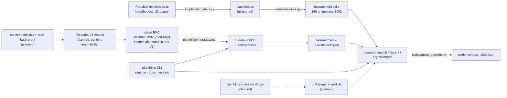

# Plumbline

**Checks Portaldot's documented calls against the runtime they claim to describe: documented call → verdict → proof** (the target flow; today it reports a comparison class per call, measured on mainnet spec 1002).


> README v0, written at the end of build day 1 (2026-10-14). Everything below describes what exists in this repo today;
> planned parts are marked **planned**. The Portaldot V3 testnet was not reachable when this was written, so no V3
> claim is made anywhere in this file.

## Project Name

**Plumbline** (`portaldot-plumbline`, CLI `plumbline`) — team `edycu`, Portaldot Hacker House 2026.

## Project Overview

### Problem Statement

Developers build against Portaldot from its published documentation. The documentation and the runtime can disagree:
a page documents an extrinsic the runtime does not have, or documents arguments the runtime does not take. (The pages do not say which runtime spec they describe; Plumbline treats them as describing the live runtime, so a gap is either a documentation defect or documentation for a different runtime version — both are worth knowing.) Today the only
way to find out is to submit a transaction and read the error. Every runtime upgrade can move that line again.

### Solution

Plumbline reads the documented call surface and the runtime's own metadata, compares them call by call, and reports a
comparison class per call (match / absent / arg-mismatch). Per-call verdicts now come from the drift ledger
(`evidence/ledger_1002.json`); proofs on V3 are **planned**. The first measurement, on the Portaldot mainnet runtime (spec 1002, read-only), is shipped:

| `mainnet-1002` baseline | Count |
|---|---|
| Extrinsic docs pages parsed | 22 / 22 |
| Documented calls | 196 |
| Documented but absent from the runtime | 64 |
| Documented with arguments that differ from the runtime (name, count or type) | 15 (4 of them differ only by a leading underscore on the runtime's parameter name) |

Source: `evidence/docs_1002.json` (written by `scripts/docs_baseline.py`, 2026-10-14). These are raw comparison classes; the
drift ledger turns them into per-call verdicts (see Roadmap); proofs on V3 are **planned**.

### Blockchain Relevance

Plumbline works on Portaldot's own surface: Substrate runtime metadata and the extrinsics the official docs describe.
It is meant to be run against each runtime Portaldot ships. The target is **Portaldot V3**; the V3 run is **pending**
(V3 testnet unreachable on 2026-10-14). Until it is reachable, the only Portaldot chain measured is the mainnet runtime,
spec 1002, read-only, as a baseline; a local upstream polkadot-sdk dev chain (interim-sdk, a stand-in, not V3) is used
only as test input and to exercise the canary runner.

## Technical Architecture



Solid boxes exist in this repository; dashed ones are **planned**. This diagram is from build day 1: the drift
ledger, `plumbline check` and canary v0 (interim stand-in chain only, not V3) have shipped since — see Roadmap.

**Core tech stack**

| Part | Choice |
|---|---|
| Blockchain platform | Measured on: Portaldot mainnet, spec 1002, read-only. Target: **Portaldot V3** (not yet run). Interim stand-in: upstream polkadot-sdk `substrate-node --dev` (profile `interim-sdk`), **not V3** |
| Contract language | none yet (see Smart Contracts) |
| Frontend framework | none (command-line tool) |
| Other components | Python 3.10+, [`substrate-interface`](https://github.com/polkascan/py-substrate-interface) 1.8.1 + `scalecodec` 1.2.12 (the SDK Portaldot's docs point to), `typer`, `pytest` |

**Chain profiles** (`plumbline/metadata.py`): `mainnet-1002` (legacy type-registry preset, Assets u64 override),
`v3` (no preset; stub until the testnet is reachable), `interim-sdk` (no preset), `stored:<file>` (offline blob). Live
profiles check the chain's identity before decoding and fail loudly on a mismatch: `mainnet-1002` and `interim-sdk` pin
`spec_name`, genesis hash and `spec_version`; `v3` pins only the spec name until the testnet has been observed; `stored:`
profiles are offline and are labelled from the blob's recorded sha256. Every `runtime` and comparison result carries its
profile label.

## Smart Contracts

There is **no contract yet**. The Plumbline Ledger (a Revive Solidity contract that records verdicts on-chain) is
**planned** for V3; no directory, address or deployment exists for it.

What the code uses today is read-only chain RPC through `substrate-interface`:
`state_getRuntimeVersion`, `chain_getBlockHash`, `chain_getFinalizedHead`, `state_getMetadata` and
`state_getStorageHash` (for `:code`), plus the SDK's own initialisation calls. `scripts/interim_node.sh` also calls
`system_health` with `curl` (interim node isolation check). Transactions are sent only to the local interim stand-in
chain (not V3): `plumbline canary` signs three dev-key extrinsics there (`Balances.transfer_keep_alive`,
`System.remark_with_event`, `Revive.map_account`) and reads each back from its block — see `docs/PROOF.md`. Nothing is
sent to mainnet and nothing is deployed, so there are no contract or asset IDs to list.

## Installation & Setup

**Requirements:** Python 3.10+ (tested on 3.11.1), network access to `mainnet.portaldot.io` and
`portaldot-dev.readthedocs.io` for the live steps. The interim node step additionally needs macOS arm64 and the
polkadot-sdk `substrate-node` binary (release `polkadot-stable2606-3`, sha256
`e687db4993973bd83922cfa9f01e29bb549af16560511b1fd51ff883b996207f`) at
`~/.cache/plumbline-interim/substrate-node-aarch64-apple-darwin`.

**Steps** (all run on 2026-10-14):

```bash
# (the repository is private until the organisers' public flip; this URL works once it is public)
git clone https://github.com/edycutjong/portaldot-hackathon-2026-plumbline-edycu.git
cd portaldot-hackathon-2026-plumbline-edycu
python3 -m venv .venv && . .venv/bin/activate
pip install -e '.[dev]'

pytest -q                                   # 244 passed, 3 deselected (live tests are opt-in: pytest -m live)

# identify the stored mainnet spec-1002 runtime (offline)
plumbline runtime -p stored:fixtures/metadata_1002.scale

# identify the live mainnet runtime (read-only RPC)
plumbline runtime -p mainnet-1002

# fetch the 22 extrinsic docs pages into a gitignored cache, then compare with the stored runtime
python scripts/fetch_docs.py
plumbline docs -p stored:fixtures/metadata_1002.scale
#   parsed 22/22 pages (22 complete), 196 documented calls
#   vs mainnet-1002 (155 live calls): absent 64, arg-mismatch 15, args-unknown 0, match 117, undocumented live 23

# regenerate the evidence file
python scripts/docs_baseline.py --profile stored:fixtures/metadata_1002.scale --out evidence/docs_1002.json

# optional: the interim stand-in chain (ws://127.0.0.1:39944, archive mode, isolated, NOT V3)
scripts/interim_node.sh start
plumbline runtime -p interim-sdk
scripts/interim_node.sh stop
```

There is nothing to compile or deploy and there is no frontend to launch yet.

## Demo

- **Video:** coming at check-in.
- **Live demo:** none yet.
- **Test data:** no accounts needed. Inputs are `fixtures/metadata_1002.scale` (mainnet spec 1002, read-only fetch) and
  the fetched docs pages. `fixtures/metadata_standin_sdk.scale` is a **stand-in, not V3** metadata blob used as test input
  only.
- **Evidence** (measured outputs, each written by a script in `scripts/`):
  - `evidence/metadata_1002.json` — mainnet spec 1002, metadata V13, sha256 `b87080f9…9053`, 153205 bytes, fetched 2026-10-14
  - `evidence/docs_1002.json` — the baseline table above
  - `evidence/metadata_standin_sdk.json` — interim-sdk stand-in (not V3), metadata V14, pinned to genesis
- **Tests:** 244 passed (+3 live, opt-in) as of 2026-10-14.

## Roadmap

**Completed (build day 1, 2026-10-14)**
- Chain profiles with identity checks; `plumbline runtime`
- Mainnet spec 1002 metadata stored with sha256 and fetch time
- Docs parser for the 22 extrinsic pages (three page layouts), `plumbline docs`, baseline of 196 / 64 / 15
- Isolated interim stand-in chain script (not V3)
- V3 guide + FAQ parser (`plumbline guide`) and the drift ledger on mainnet-1002 (`plumbline plumb`, `evidence/ledger_1002.json`)
- Runtime diff (`plumbline diff`), offline dapp check (`plumbline check`, golden output for mainnet-1002 in
  `fixtures/expected_check_1002.txt`), canary v0 with read-back on the interim chain only (`docs/PROOF.md`, not V3)

**Next (planned)**
- Run against the Portaldot V3 testnet as soon as it is reachable; Plumbline Ledger contract (Revive) on V3

## Team

- **Team name:** edycu
- **Members & roles:** edycu — solo, design, review and submission
- **Contact (hackathon only):** via the Portaldot Hacker House Discord / DoraHacks BUIDL page

**AI assistance disclosure.** Claude Code (Anthropic) was used for most of the code drafting in this repository; the
author reviews it and is responsible for it. Architecture, scope and protocol choices are the author's. Code in this
repository was written during the hackathon window (from 2026-10-14).

**Open-source credits:** `substrate-interface` / `scalecodec` (Polkascan, Apache-2.0), `typer` (MIT), `pytest` (MIT);
node binary for the interim chain from [paritytech/polkadot-sdk](https://github.com/paritytech/polkadot-sdk) releases.
Documentation pages are fetched from Portaldot's public readthedocs at run time and are not copied into this repo.

## License

MIT — see [LICENSE](LICENSE).
