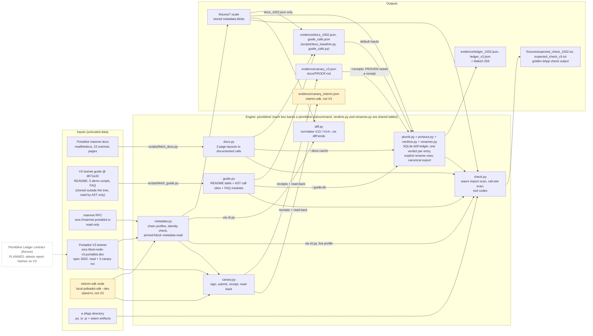

<a id="plumbline"></a>

<div align="center">
  
  <h1>Plumbline 📐</h1>
  <p><em>Checks Portaldot's documented calls against the runtime they claim to describe: documented call → verdict → proof.</em></p>
  

  <br/>

  [](https://plumbline.edycu.dev)
  [](https://github.com/edycutjong/portaldot-hackathon-2026-plumbline-edycu/blob/main/docs/pitch-deck.pdf)
  [](https://youtu.be/edvFuOdUZNk)
  [](https://dorahacks.io/build/50127)

  <br/>

  [](https://github.com/edycutjong/portaldot-hackathon-2026-plumbline-edycu/actions/workflows/ci.yml)
  
  
  
  

</div>

---

Today it gives a verdict for every documented call on the Portaldot V3 testnet (spec 3002) and on mainnet (spec 1002), diffs the two runtimes, checks a dApp against either, and has sent 3 canary transactions to V3 and read them back from their blocks. Every other documented entry on V3 is at most UNPROVEN (present, no transaction sent), or ARGS-UNCHECKED / UNKNOWN-DOC (nothing to compare), or carries a drift verdict (ABSENT, ARG_DRIFT).

**First V3 findings (measured 2026-10-19, spec 3002; details in [`docs/BASELINE-V3.md`](docs/BASELINE-V3.md)):** `Balances.transfer`, which the mainnet docs list, does not exist on V3 (verdict ABSENT); 5 of the 12 modules the V3 guide's FAQ lists for V3.0 are not on the testnet (by pallet name); the 79 mainnet-docs calls that disagree with the runtime on spec 1002 become 2 on V3; the chain reports `portaldot-v3`/3002/`tPOT`/69 pallets where the V3 guide said `tPOTv3` and a third-party measurement (see `docs/BASELINE-V3.md`) said `portaldotV3`/3000/70.

> Check-in README (v1, refreshed 2026-10-20 with the first Portaldot V3 measurements). It describes what exists in this
> repository today; planned parts are marked **planned**. Chain measurements are labelled with their profile: `v3` (the
> V3 testnet, spec 3002, measured 2026-10-19), `mainnet-1002` (read-only baseline, 2026-10-14) or `interim-sdk` (a local
> stand-in chain, **not V3**, kept as test input). One cited exception: the two wasm cells inside `plumbline check` rest on
> a 2026-10-11 measurement on a local spec-1002 chain, made before this repository existed and not re-run here (see
> `docs/BASELINE-1002.md`).

<a id="project-name"></a>

## 🏷️ Project Name

**Plumbline** (`portaldot-plumbline`, CLI `plumbline`) — team `edycu`, Portaldot Hacker House 2026, track Modular Cloud & Middleware.

<a id="project-overview"></a>

## 💡 Project Overview

### Problem Statement

Developers build against Portaldot from its published documentation. The documentation and the runtime can disagree:
a page documents an extrinsic the runtime does not have, or documents arguments the runtime does not take. (The pages do
not say which runtime spec they describe; Plumbline treats them as describing the live runtime, so a gap is either a
documentation defect or documentation for a different runtime version, and both are worth knowing.) One way to
find out is to submit a transaction and read the error, and every runtime upgrade can move that line again.

### Solution

Plumbline reads the documented call surface and a runtime's own metadata, compares them call by call, and writes one
verdict per call into a drift ledger. A call is **PROVEN** only when a canary transaction for it succeeded on that
runtime and was read back from its block; otherwise the ledger says what it could and could not establish
(ABSENT, DRIFTED, ARG_DRIFT, UNPROVEN, …; definitions in `plumbline/verdicts.py`).

**The core flow, with what exists today:**

| Step | What Plumbline does | Status |
|---|---|---|
| 1. Documented call | Parses the 22 mainnet extrinsic docs pages (196 calls) and the V3 guide at commit `d671a32` (46 sample-code `compose_call` sites, 12 FAQ modules) | shipped |
| 2. Verdict | Joins each entry to one runtime's metadata and writes exactly one verdict, stamped with profile, spec version and metadata hash | shipped on `v3` and `mainnet-1002` |
| 3. Proof | Signs a canary extrinsic, keeps the receipt, re-reads it from its block by hash | shipped: 3 calls PROVEN on `v3` (`docs/PROOF.md`); a local stand-in run (`interim-sdk`, **not V3**) is kept beside it. Of the other 193 mainnet-docs calls, 191 are UNPROVEN on V3 (present, no transaction) and 2 disagree with the V3 runtime |

**Measured on the Portaldot mainnet runtime (spec 1002, read-only), 2026-10-14:**

| `mainnet-1002` baseline | Count |
|---|---|
| Extrinsic docs pages parsed | 22 / 22 |
| Documented calls | 196 |
| Match (name and arguments) | 117 |
| Documented but absent from the runtime | 64 (62 ABSENT, 2 DRIFTED: `Proxy.create_pure` / `kill_pure` → `Proxy.anonymous` / `kill_anonymous`) |
| Documented with arguments that differ from the runtime | 15 (4 of them differ only by a leading underscore on the runtime's parameter name) |
| Live calls whose names no docs page lists | 23 (2 are the live sides of the renamed proxy calls) |

Full table with producers and dates: [`docs/BASELINE-1002.md`](docs/BASELINE-1002.md). Ledger: `evidence/ledger_1002.json`
(320 verdict rows, blake2-256 `d067b31b…de21ee7`, reproduced byte for byte from freshly fetched inputs).
**101 of the 320 rows come from the V3 guide's own call table, demo scripts and FAQ; their verdicts there are computed against
mainnet spec 1002 and are not V3 findings.**

**Measured on the Portaldot V3 testnet (profile `v3`, spec `portaldot-v3`/3002), 2026-10-19:**

| `v3` finding | Value |
|---|---|
| Identity the sources gave → what the chain reports | spec `portaldotV3`/3000, symbol `tPOTv3`, 70 pallets → `portaldot-v3`/**3002**, **`tPOT`**, **69** pallets |
| Runtime | 69 pallets, 480 calls (mainnet-1002: 31 / 155); metadata V14, sha256 `38101435…394c` |
| Diff `mainnet-1002` → `v3` | 516 rows: 40 pallets added, 2 removed (`Gilt`, `RandomnessCollectiveFlip`), 73 calls added, 12 removed, 2 renamed (`Proxy.anonymous` → `create_pure`, `Proxy.kill_anonymous` → `kill_pure`), 99 argument changes, 119 constant changes, 169 event changes (`docs/BASELINE-V3.md`) |
| Mainnet docs vs the runtime | the 79 calls whose docs and runtime disagree on spec 1002 become **2** on V3 (`Balances.transfer` absent, `ElectionProviderMultiPhase.governance_fallback` arguments) |
| V3 guide's sample code | all 46 `compose_call` sites (46 distinct calls; one site is dynamic and resolves to two) name calls that exist on V3 |
| V3 guide FAQ | 5 of the 12 modules the guide's FAQ lists for V3.0 are not on the V3 testnet: `conviction_voting`, `cumulus_parachain_system`, `ibridge`, `paras`, `referenda` (by pallet name) |
| `plumbline check examples/mainnet-dapp --target v3` | 9 findings, blocking 0 (on mainnet-1002: blocking 5) |
| Canaries | `System.remark_with_event`, `Balances.transfer_keep_alive` (to itself), `Utility.batch_all`: 3 transactions, blocks 106424–106426, all success, read back 3/3 |

V3 canary transactions (signer `5EhP3KWtUkaRuFUoejCfmYHfi54d2fomNFoyVjNFFsRUzDsb`, each re-read from its block; the same table, with block hashes, is in [`docs/PROOF.md`](docs/PROOF.md); look them up by block number or block hash in the Portaldot-hosted V3 console, https://node-console.portaldot.dev/ , which has no tx-hash search):

| Call | Extrinsic | Tx hash |
|---|---|---|
| `System.remark_with_event` | `106424-1` | `0xf54430571069e41bfe629c6c77609a279d0ad82fa2a83e45b0c3575bc941e6f5` |
| `Balances.transfer_keep_alive` (to itself) | `106425-1` | `0xa7effe5d5ab7d7c512690d285065fd83919f8b83dc04de1630e1e4ddff91d90b` |
| `Utility.batch_all` | `106426-1` | `0x25e0352284f3a2455e03c7c02c625b8bd1ff692e244bafbc51d1adf20f5dfaa8` |

Full tables, producers and dates: [`docs/BASELINE-V3.md`](docs/BASELINE-V3.md); every transaction hash: [`docs/PROOF.md`](docs/PROOF.md).
V3 ledger: `evidence/ledger_v3.json` (549 verdict rows, blake2-256 `dc808404…1e34`).

Other tools in the repo: `plumbline diff A B` lists the pallets, calls, arguments, constants and events that differ between
two runtimes (an argument row with equal names but different types is flagged `names_equal`: spelling only or a real change,
the diff cannot tell; type aliases are not resolved, so a same-named alias whose width changes yields no row; it prints a **STAND-IN, NOT V3** banner when a side is the stand-in chain); `plumbline check <dApp dir>
--target <profile>` classifies each call site and wasm import set in a dApp against a runtime (blocking: ABSENT, DRIFTED, ARG_DRIFT,
EXPECTED-REJECT; TYPE-TRAP is not detected yet; wasm verdicts cover two measured cases only), with exit codes 0 / 1 / 2.
Golden `check` outputs are committed for `mainnet-1002` (`fixtures/expected_check_1002.txt`) and `v3` (`fixtures/expected_check_v3.txt`).

### Blockchain Relevance

Plumbline works on Portaldot's own surface: Substrate runtime metadata, the extrinsics the published mainnet docs (portaldot-dev.readthedocs.io) describe, and the
V3 testnet guide. It is meant to be re-run against each runtime Portaldot ships. The target is **Portaldot V3**, measured
on 2026-10-19 (spec 3002); mainnet spec 1002 (read-only) is the baseline it is compared with; a local upstream
polkadot-sdk dev chain (`interim-sdk`, a stand-in, **not V3**) is kept as test input and for the canary runner's first run.

<a id="technical-architecture"></a>

## 🏗️ Technical Architecture


*Drawn from the code in `plumbline/`. Heavy lines are the core flow (1 documented call → 2 verdict → 3 proof) and the reads that feed it; dashed is planned; the hatched chain is the local stand-in, not V3. Source: [`docs/architecture.html`](docs/architecture.html).*

<details>
<summary>Diagram as text (Mermaid)</summary>



</details>

Solid boxes exist in this repository; dashed boxes are **planned**; yellow boxes are the stand-in chain and what it
produced (**not V3**); the V3 testnet is a solid box. Drawn from the code; explained step by step in [`docs/ARCHITECTURE.md`](docs/ARCHITECTURE.md).

**Core tech stack**

| Part | Choice |
|---|---|
| Blockchain platform | **Portaldot V3 testnet** (profile `v3`, `portaldot-v3`/3002): read-only metadata plus 3 canary transactions. Baseline: Portaldot mainnet, spec 1002, read-only. Test input only: upstream polkadot-sdk `substrate-node --dev` (profile `interim-sdk`), **not V3** |
| Contract language | none yet (see Smart Contracts) |
| Frontend framework | none (command-line tool) |
| Other components | Python 3.10+, [`substrate-interface`](https://github.com/polkascan/py-substrate-interface) 1.8.1 + `scalecodec` 1.2.12 (the SDK Portaldot's docs point to), `typer`, `pytest`, SQLite (the ledger) |

**Chain profiles** (`plumbline/metadata.py`): `mainnet-1002` (legacy type-registry preset, Assets u64 override),
`v3` (no preset), `interim-sdk` (no preset), `stored:<file>` (offline blob). Live
profiles check the chain's identity before decoding and fail loudly on a mismatch: `mainnet-1002`, `v3` and `interim-sdk` pin
`spec_name`, genesis hash and `spec_version` (`v3`: `portaldot-v3`, genesis `0xd4f9acbc…5283bd`, 3002); `stored:`
profiles are offline and are labelled from the blob's recorded sha256. Every `runtime`, `plumb`, `diff` and `check` result
carries its profile label.

**Third-party inputs are untrusted data.** The V3 guide is cloned at a pinned commit outside this tree and read by AST and
text only, never executed. At HEAD its text is not copied here: `evidence/guide_calls.json` holds names and `file:line`
references only (two short FAQ status phrases appear in the tree snapshots of eight early commits, before `d92203e`; HEAD holds none). The mainnet docs pages are fetched at run time into a gitignored cache.

<a id="smart-contracts"></a>

## 📜 Smart Contracts

There is **no contract yet**. The Plumbline Ledger (a Revive Solidity contract that would record verdict-report hashes
on-chain) is **planned** for V3; no directory, address or deployment exists for it. Plumbline is pallet-native today: it
reads chain metadata and sends transactions only with `plumbline canary`.

RPC and SDK calls used, read-only: `state_getRuntimeVersion`, `chain_getBlockHash`, `chain_getFinalizedHead`,
`state_getMetadata`, `state_getStorageHash` (for `:code`), `System.Account` and `Balances.ExistentialDeposit` reads, block and
extrinsic reads for read-back, and the SDK's own initialisation calls. `scripts/interim_node.sh` also calls `system_health`
with `curl` (isolation check). Extrinsics are sent only by `plumbline canary`:

- **profile `v3`** (Portaldot V3 testnet): `System.remark_with_event`, `Balances.transfer_keep_alive` to the signing account
  itself, and `Utility.batch_all` of one remark, signed by one funded canary account
  `5EhP3KWtUkaRuFUoejCfmYHfi54d2fomNFoyVjNFFsRUzDsb` whose seed is read from a mode-600 file outside the repository
  (never printed or recorded). Blocks 106424–106426; each receipt is read back from its block (`docs/PROOF.md`,
  `evidence/canary_v3.json`, `evidence/readback_v3.txt`).
- **profile `interim-sdk`** (a local stand-in chain, **not V3**), dev keys: `Balances.transfer_keep_alive`,
  `System.remark_with_event` and `Revive.map_account`.

Nothing is sent to mainnet and nothing is deployed, so there are no contract or asset IDs to list.

<a id="installation--setup"></a>

## 🚀 Installation & Setup

**Requirements:** Python 3.10+ (tested on 3.11.1), git, network access to `test-node-v3.portaldot.dev`, `mainnet.portaldot.io`,
`portaldot-dev.readthedocs.io` and github.com for the live steps. The interim-node step additionally needs macOS arm64
and the polkadot-sdk `substrate-node` binary (release `polkadot-stable2606-3`, sha256
`e687db4993973bd83922cfa9f01e29bb549af16560511b1fd51ff883b996207f`) at
`~/.cache/plumbline-interim/substrate-node-aarch64-apple-darwin`, or set `PLUMBLINE_INTERIM_BIN` (the script checks the hash and refuses any other file;
see its header for the default lookup).

**Steps** (every command below was run on 2026-10-14, except steps 6–7 on 2026-10-19/20):

```bash
git clone https://github.com/edycutjong/portaldot-hackathon-2026-plumbline-edycu.git
cd portaldot-hackathon-2026-plumbline-edycu
python3 -m venv .venv && . .venv/bin/activate
pip install -e '.[dev]'

pytest -q                                   # 263 passed, 3 deselected (live tests are opt-in: pytest -m live)

# 1. identify the runtime: stored mainnet spec 1002 (offline), then the live one (read-only RPC)
plumbline runtime -p stored:fixtures/metadata_1002.scale
plumbline runtime -p mainnet-1002           # same metadata sha256 b87080f9… as the stored blob on 2026-10-14

# 2. documented call -> verdict: fetch the docs and the V3 guide, build the drift ledger
python scripts/fetch_docs.py                # 22 pages into .cache/docs (gitignored)
plumbline docs -p stored:fixtures/metadata_1002.scale
#   parsed 22/22 pages (22 complete), 196 documented calls
#   vs mainnet-1002 (155 live calls): absent 64, arg-mismatch 15, args-unknown 0, match 117, undocumented live 23
python scripts/fetch_guide.py               # clones the guide at the pinned commit into ~/.cache/plumbline-sources/guide
plumbline guide                             # 46 compose_call sites by AST, 12 FAQ modules
plumbline plumb -p stored:fixtures/metadata_1002.scale --runtime-record evidence/metadata_1002.json --out ledger.json \
    --docs-cache .cache/docs --guide-dir ~/.cache/plumbline-sources/guide
#   320 verdict rows; ledger.json is byte-identical to evidence/ledger_1002.json

# 3. what changes between two runtimes (mainnet-1002 vs the stand-in: banner says NOT V3, no number is used)
plumbline diff mainnet-1002 stored:fixtures/metadata_standin_sdk.scale --kind arg-changed

# 4. which of a dApp's calls the runtime does not list, or lists differently (exit code 1 = blocking findings)
plumbline check examples/mainnet-dapp --target mainnet-1002 --offline   # = fixtures/expected_check_1002.txt

# 5. proof runner on the stand-in chain (NOT V3): start, send 3 canaries, read them back, stop
scripts/interim_node.sh start               # ws://127.0.0.1:39944, archive mode, isolated (0 peers)
plumbline canary -p interim-sdk --replace   # rewrites evidence/canary_interim.json and docs/PROOF.md
plumbline readback evidence/canary_interim.json
scripts/interim_node.sh stop

# 6. the Portaldot V3 testnet (profile v3, read-only): identify, diff against mainnet, check a dApp
plumbline runtime -p stored:fixtures/metadata_v3.scale     # V14, sha256 38101435…394c, 69 pallets, 480 calls
plumbline runtime -p v3                                    # portaldot-v3/3002, live (the sha256 can differ by one byte at a later block: see docs/BASELINE-V3.md)
plumbline diff stored:fixtures/metadata_1002.scale stored:fixtures/metadata_v3.scale    # 516 rows (evidence/diff_1002_v3.json)
plumbline check examples/mainnet-dapp --target v3                                       # blocking 0 (evidence/check_v3.txt)
python scripts/build_ledger.py --profile stored:fixtures/metadata_v3.scale --runtime-record evidence/metadata_v3.json \
    --receipts evidence/canary_v3.json --out /tmp/ledger_v3.json     # 549 rows; byte-identical to evidence/ledger_v3.json

# 7. V3 canaries: needs a funded seed file (see Smart Contracts); sends 3 transactions
plumbline canary -p v3 --replace            # rewrites evidence/canary_v3.json and docs/PROOF.md
plumbline readback evidence/canary_v3.json  # 3/3 receipts match the chain
```

To regenerate the docs baseline evidence: `python scripts/docs_baseline.py --profile stored:fixtures/metadata_1002.scale --out evidence/docs_1002.json`.
There is nothing to compile or deploy and there is no frontend to launch.

<a id="demo"></a>

## 🎬 Demo

- **Video:** demo: https://youtu.be/edvFuOdUZNk
- **Pitch deck:** [`docs/pitch-deck.pdf`](docs/pitch-deck.pdf) (10 pages, printed from [`deck/index.html`](deck/index.html))
- **Live demo:** none; Plumbline is a command-line tool.
- **Test accounts / test data:** no accounts are needed for steps 1–4 and 6 (read-only); step 7 needs one funded V3 account. The stand-in chain uses the well-known dev keys
  (`//Alice` and per-run `//Plumbline//<run id>` accounts), which are refused on every other profile. Inputs are
  `fixtures/metadata_1002.scale` (mainnet spec 1002, read-only fetch), the fetched docs pages, and
  `examples/mainnet-dapp/` (an engineered fixture written for `check`, never run).
  `fixtures/metadata_standin_sdk.scale` is a **stand-in, not V3** blob used as test input only.
- **Evidence** (measured outputs, each written by a script or a `plumbline` command; see `evidence/README.md`):
  - `docs/BASELINE-1002.md` — every mainnet-1002 figure with its producer and date
  - `evidence/metadata_1002.json` — mainnet spec 1002, metadata V13, sha256 `b87080f9…9053`, 153205 bytes, fetched 2026-10-14
  - `evidence/docs_1002.json` — 196 documented calls vs the runtime (117 / 64 / 15)
  - `evidence/guide_calls.json` — the V3 guide's call table at `d671a32` (names and `file:line` only)
  - `evidence/ledger_1002.json` (+ `.blake2-256`) — the drift ledger, 320 verdict rows
  - `docs/BASELINE-V3.md`, `evidence/metadata_v3.json`, `evidence/diff_1002_v3.json`, `evidence/baseline_v3.json`, `evidence/ledger_v3.json`, `evidence/check_v3.txt` — the V3 findings above, with producers and dates
  - `evidence/canary_v3.json`, `evidence/readback_v3.txt` and `docs/PROOF.md` — 3 transactions on the V3 testnet (`106424-1`, `106425-1`, `106426-1`), all success, 3/3 read back
  - `evidence/canary_interim.json` and `docs/PROOF.md` (second section) — **interim-sdk — not V3**: run `20261014T144705Z`, node/268,
    3 extrinsics (`3040-2` `Balances.transfer_keep_alive`, `3041-2` `System.remark_with_event`, `3042-2`
    `Revive.map_account`), all success, read back 3/3 from a new process after a node restart (`evidence/readback_interim.txt`)
- **Tests:** 263 passed (+3 live, opt-in) on 2026-10-20.

<a id="development"></a>

## 🧪 Development

```bash
pip install -e '.[dev]'
ruff check .          # lint
python -m pytest -q   # offline tests; live tests are opt-in (pytest -m live)
```

CI (`.github/workflows/`) runs lint, the offline tests on Python 3.10–3.12 and a package build, plus CodeQL,
gitleaks and pip-audit. None of it needs a key or a live chain write. See [CONTRIBUTING.md](CONTRIBUTING.md).

<a id="roadmap"></a>

## 🗺️ Roadmap

**Completed (2026-10-14 to 2026-10-20)**
- Chain profiles with identity checks; `plumbline runtime`; mainnet spec 1002 metadata stored with sha256 and fetch time
- Docs parser for the 22 extrinsic pages (three layouts), `plumbline docs`, baseline of 196 / 64 / 15
- V3 guide and FAQ parser (`plumbline guide`): 46 `compose_call` sites by AST, 12 FAQ modules
- Drift ledger on mainnet-1002 (`plumbline plumb`): 320 verdict rows, deterministic export
- Runtime diff (`plumbline diff`), offline dApp check (`plumbline check`) with a golden output for mainnet-1002
- Canary runner with read-back on the local stand-in chain (not V3), isolated interim-node script
- V3 profile pinned to the live testnet (2026-10-20); `runtime`, `diff`, `plumb` and `check` run against it; V3 metadata stored; 3 canary transactions on V3 read back from their blocks; canary receipts feed the ledger (`plumb --receipts`)

**Next (planned)**
- A canary per documented call (3 of 196 mainnet-docs calls are PROVEN on V3, 191 are UNPROVEN, 2 disagree with the V3 runtime)
- Plumbline Ledger contract (Revive) on V3

<a id="team"></a>

## 👥 Team

- **Team name:** edycu
- **Members & roles:** edycu — solo, design, review and submission
- **Contact (hackathon only):** via the Portaldot Hacker House Discord / DoraHacks BUIDL page

**AI assistance disclosure.** Claude Code (Anthropic) was used for most of the code drafting in this repository; the
author reviews it and is responsible for it. Architecture, scope and protocol choices are the author's. Code in this
repository was written during the hackathon window (from 2026-10-14).

**Open-source credits:** `substrate-interface` / `scalecodec` (Polkascan, Apache-2.0), `typer` (MIT), `pytest` (MIT);
node binary for the interim chain from [paritytech/polkadot-sdk](https://github.com/paritytech/polkadot-sdk) releases.
Documentation pages and the V3 testnet guide are read from their public sources at run time; at HEAD their text is not
copied into this repo.

<a id="license"></a>

## 📄 License

MIT — see [LICENSE](LICENSE).
