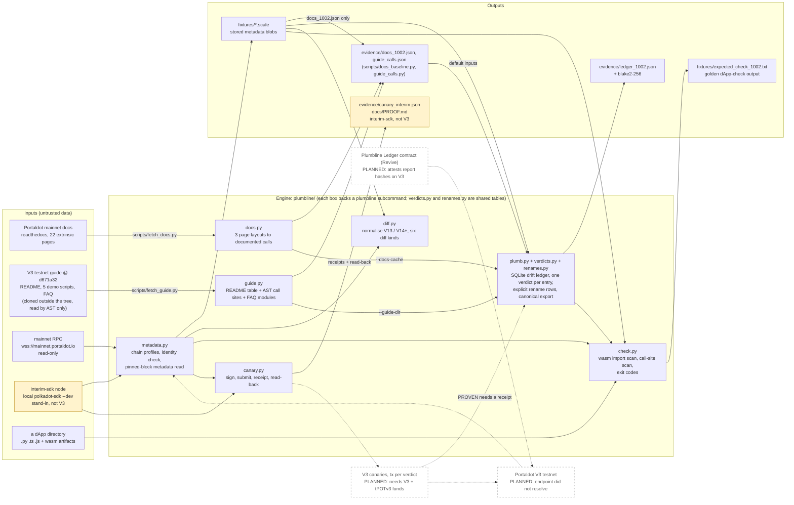

# Architecture

Drawn from the code in `plumbline/` as of 2026-10-14 (not from a plan). Solid boxes exist in this repository and have
tests; dashed boxes and dashed arrows are **planned** and are not built. The Portaldot V3 testnet did not resolve on
2026-10-14, so the V3 path is planned and every chain measurement below is `mainnet-1002` (read-only) or the
`interim-sdk` stand-in (**not V3**).

## Flow, in words

1. **Read the runtime.** `metadata.py` connects through `substrate-interface`, checks the chain's identity (spec name,
   genesis hash, spec version) against the profile and fails loudly on a mismatch, then reads the metadata blob at one
   pinned block (a finalized head or genesis) and stores it with its sha256. Profiles: `mainnet-1002` (legacy type
   registry preset plus an Assets `u64` override), `v3` (no preset, a stub until the testnet resolves), `interim-sdk`
   (no preset), `stored:<file>` (offline).
2. **Read the documentation.** `docs.py` parses the mainnet extrinsic pages (three layouts) into documented calls with
   their arguments; `guide.py` reads the V3 guide (README call table, `compose_call` / `runtime_call` sites by AST, the
   FAQ module table) into the same shape, each entry carrying its `file:line` or page reference.
3. **Decide a verdict.** `plumb.py` joins the documented entries to one runtime's call surface and writes exactly one
   verdict per entry into a SQLite ledger, then exports it as canonical JSON (sorted keys, no whitespace, UTF-8) with its
   blake2-256. The verdict names live in `verdicts.py` only. A renamed call is DRIFTED only through an explicit row in
   `renames.py`, checked against the runtime; nothing is matched fuzzily. PROVEN needs a receipt whose profile and spec
   version equal the runtime's and whose read-back decodes to the same `Pallet.call`; there is none for any real
   Portaldot chain yet, so the shipped ledger has no PROVEN row.
4. **Prove (runner only).** `canary.py` signs three calls with dev keys on the local `interim-sdk` chain, keeps each
   receipt (tx hash, block hash, extrinsic id, events), and `readback` re-fetches the block by hash and checks that the
   extrinsic at the receipt's index has the tx hash and decodes to the same call. Dev keys are refused on every other
   profile and on any non-loopback endpoint. `plumb` refuses these receipts, so they can never become a mainnet or V3
   verdict.
5. **Diff and check.** `diff.py` normalises V13 and V14+ metadata to one form and lists pallets, calls, arguments,
   constants and events that change between two runtimes (it prints a STAND-IN, NOT V3 banner at the top and bottom when a side is the
   stand-in; no number from that output is used in any document). `check.py` scans a dApp directory (Python and JS/TS call sites, wasm import sections) against one profile and
   exits 0, 1 (blocking findings) or 2 (usage or chain error).

## Invariants the code enforces

| Invariant | Where |
|---|---|
| Every verdict row carries profile, spec version and metadata hash | `plumb.py` schema and export; test in `tests/test_plumb.py` |
| Verdict strings are defined once | `verdicts.py`; a test bans the literals elsewhere |
| A recorded blob is labelled from its sha256; an unrecorded one is labelled "origin not recorded" and `plumb` refuses it, so a stand-in cannot be relabelled as V3 | `metadata.KNOWN_BLOBS`, `produce.py` |
| The stand-in chain cannot produce a verdict | `plumb.py` refuses the profile and the blob |
| Dev keys never leave the stand-in chain | `canary.dev_keypair` |
| Third-party guide text is not copied into the repo | `evidence/guide_calls.json` holds names and `file:line` only |
